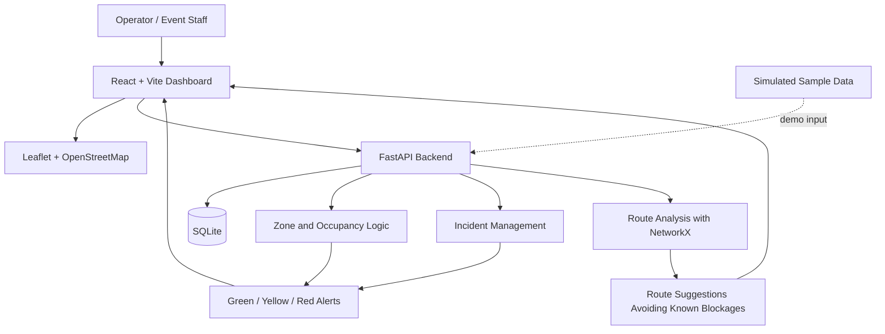

# CrowdSuraksha — Technical Design Document

## 1. Purpose and scope
CrowdSuraksha is a proposed prototype for crowd-risk awareness and emergency-response support at large gatherings. This document describes the intended design; it does not mean all components are already implemented.

## 2. Goals
- Visualize entrances, exits, roads, medical facilities, water points, and risk zones.
- Display estimated occupancy and threshold-based alerts.
- Register incidents and track status.
- Suggest routes that avoid known blocked roads.
- Demonstrate safely with simulated data.

## 3. Out of scope
- Autonomous emergency dispatch.
- Guaranteed live crowd detection.
- Replacement of police, medical staff, or incident commanders.
- Claims that the system prevents accidents.

## 4. High-level architecture



## 5. Components
- **Frontend — React/Vite/Tailwind:** map, zone indicators, incident list, and route display.
- **Mapping — Leaflet/OpenStreetMap:** show gates, roads, facilities, and known blockages. Include appropriate map attribution.
- **Backend — FastAPI:** validate records, calculate occupancy percentages, manage incidents, and provide route suggestions.
- **Database — SQLite:** store prototype zones and incidents. Production requires security, backup, access control, and monitoring.
- **Routing — NetworkX:** represent intersections as graph nodes and roads as edges; exclude known blocked edges when computing candidate routes.
- **Optional computer vision — OpenCV + YOLO:** possible future video-based person detection/crowd estimation. Do not claim it works unless implemented and tested.

## 6. Example alert logic
```text
occupancy_percent = estimated_people / capacity * 100

if occupancy_percent < 60:
    status = GREEN
elif occupancy_percent < 85:
    status = YELLOW
else:
    status = RED
```
These thresholds are illustrative only, not validated safety standards. Reject negative counts and non-positive capacity. Show missing or stale data clearly.

## 7. Suggested API contract
These are suggestions; list only endpoints that actually exist in your implementation.

| Method | Endpoint | Purpose |
|---|---|---|
| GET | `/health` | Service health |
| GET | `/zones` | List zones |
| GET | `/zones/{zone_id}` | Read zone and demo occupancy |
| GET | `/incidents` | List incidents |
| POST | `/incidents` | Register incident |
| PATCH | `/incidents/{incident_id}` | Update incident status |
| POST | `/routes/suggest` | Suggest route avoiding known blocked edges |

Example incident payload:
```json
{
  "type": "blocked_route",
  "zone_id": "ZONE-02",
  "description": "Demonstration: passage marked as blocked",
  "status": "open",
  "source": "simulated"
}
```

## 8. Suggested data model
- **Zone:** id, name, capacity, estimated_people, risk_status, last_updated.
- **Incident:** id, type, zone_id, description, status, created_at, source.
- **MapPoint:** id, label, category, latitude, longitude.
- **RoadEdge:** from_node, to_node, distance, blocked, last_updated.

Validate coordinates and values. Keep personal information out of sample data.

## 9. Safety, privacy, and reliability
- Label simulated, stale, and missing data.
- Require human verification for incidents and response decisions.
- Define fallback procedures for network/app failure.
- Minimize personal data and define retention rules.
- Protect operational data in future deployments.
- Test that suggested routes avoid blocked edges.
- Never commit secrets.

## 10. Testing strategy
1. Unit tests for occupancy calculations and threshold boundaries.
2. API tests for valid/invalid incident submissions.
3. Database tests for incident status updates.
4. Route tests for blocked edges and unavailable paths.
5. UI checks for labels, map layers, and error states.
6. Manual demo checks with sample data.

## 11. Deployment concept
For a local demo, run frontend and backend separately and configure the API URL through environment variables. Do not use as a real emergency service without expert review, validated data, security assessment, reliability testing, and authorization.

## 12. Confirm before release
- Actual folder layout and startup commands.
- Which endpoints are implemented.
- How data is loaded and persisted.
- Whether routing is functional or illustrative.
- Whether OpenCV/YOLO is implemented.
- License and attribution requirements for third-party assets.
